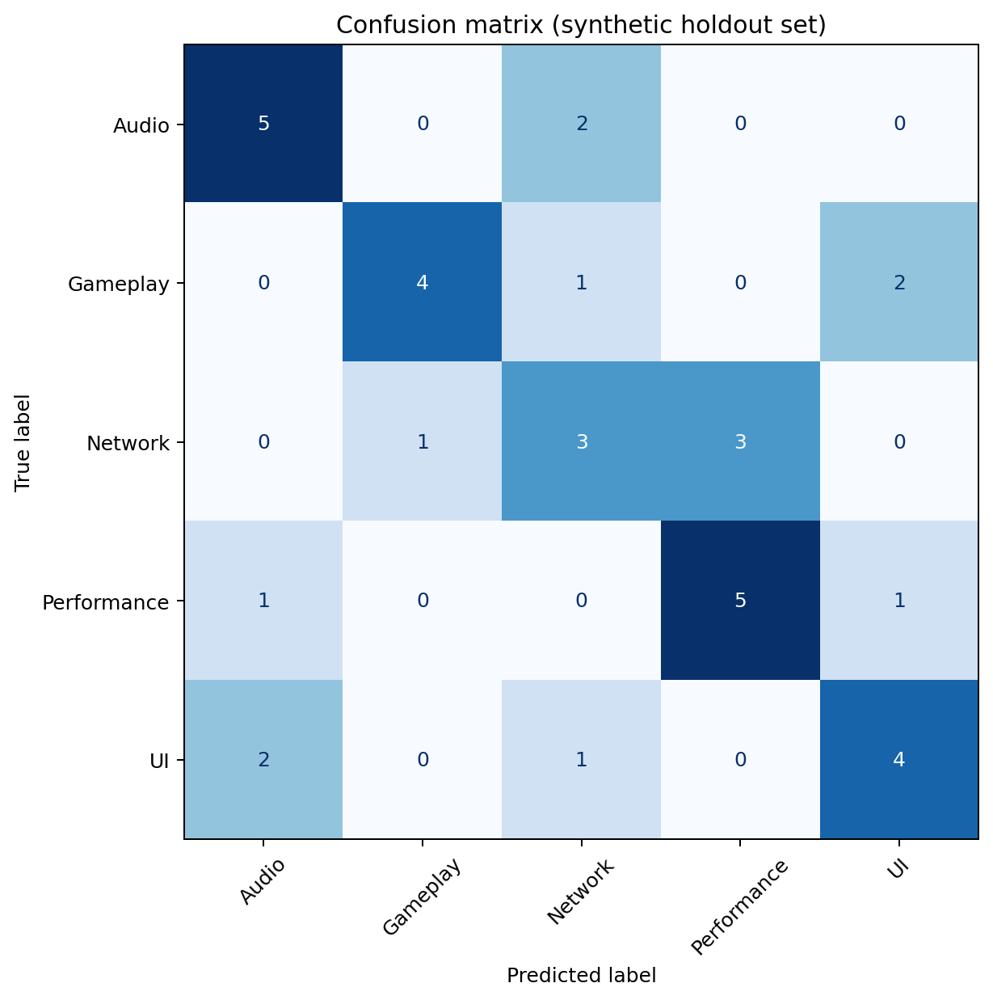

# Game Bug Classification and Analysis System

This is a personal Python project exploring how text classification could help a game QA team sort incoming bug reports. It includes a set of sample test cases and a simple machine learning model. It is a learning project, not a tool that automatically finds defects in games.

The examples are fictional and are not based on testing performed for an employer. No company documents, private game builds or player records are included.

## Project contents

| File | Description |
| --- | --- |
| `data/game_test_cases.csv` | 50 proposed test cases covering core gameplay and common PC game features. |
| `data/demo_bug_reports.csv` | 40 fictional bug reports used to demonstrate text classification. |
| `data/game_observations.csv` | An empty template for recording future tests conducted independently. |
| `make_demo_data.py` | Recreates the fictional reports in the dataset. |
| `main.py` | Trains the classifier and saves evaluation results. |
| `game_test_helper.py` | Suggests categories for new observations entered in the template. |

## Test case design

The test cases cover starting and closing a session, controls, movement, inventory, combat, saving, menus, audio, multiplayer and performance. Each case includes a starting condition, steps, expected result, priority and test type.

These are **proposed tests, not completed test runs**. The execution status is set to `Not run`, and the actual result is blank. Some cases apply only to games with the relevant feature. The expected results should be checked against the specifications of any game selected for testing.

## How the classifier works

The model uses the written description of a bug report as input. First, Pandas loads the labelled sample reports. TF-IDF converts their text into numerical features, and a Logistic Regression model learns to suggest one of five categories: `Audio`, `Gameplay`, `Network`, `Performance` or `UI`.

The data is divided into training and test sets using a fixed random seed and stratified sampling. The program reports accuracy, macro F1, precision, recall and a confusion matrix. Its predictions are category suggestions for manual review, not proof that a particular defect exists.

## Running the project

Use Python 3.10 or later. From the project folder, run:

```bash
python -m pip install -r requirements.txt
python make_demo_data.py
python main.py
```

To try the classification helper, add your own original observations to `data/game_observations.csv`. The `description` column is required. Then run:

```bash
python game_test_helper.py
```

## Model results

The evaluation report is saved to `output/evaluation.txt`. The chart below shows how the classifier assigned categories to the held-out sample reports.



The dataset contains only 40 fictional reports, so the test set is small and the results are unstable. These scores do not demonstrate accuracy on genuine player bug reports. Some categories overlap, and real issue descriptions often contain information about more than one system.

The review queue in `output/review_queue.csv` is a demonstration produced from the available reports. It is not an independent test result, and its model scores should not be interpreted as calibrated probabilities.

## What I would improve next

I would collect a larger set of independently recorded reports with appropriate permission, check labels for consistency, and keep a separate test set from games or testers not represented in training. I would also review misclassified reports and compare the model with a simple keyword baseline before making claims about practical usefulness.

## Repository structure

```text
game-bug-classification/
├── README.md
├── requirements.txt
├── make_demo_data.py
├── main.py
├── game_test_helper.py
├── data/
│   ├── game_test_cases.csv
│   ├── demo_bug_reports.csv
│   └── game_observations.csv
└── output/
    ├── evaluation.txt
    ├── confusion_matrix.png
    ├── category_counts.png
    ├── test_predictions.csv
    └── review_queue.csv
```

## Data use

The included reports are deliberately invented. Any future reports should come from independent testing or sources that permit reuse. Employer documents, confidential test results and personal information should not be added to this repository.

